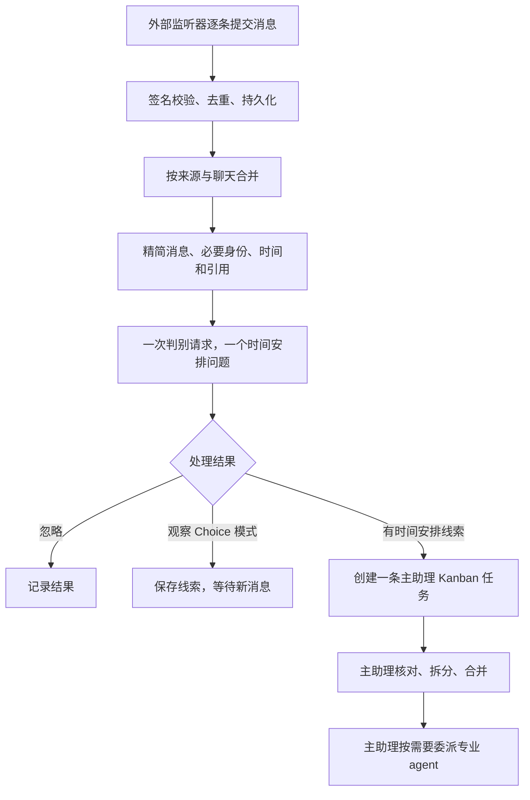

# Hermes WeChat Router

把外部监听器提交的微信消息合并成批次，用 **Google Gemini Decisions 或 Jev** 初筛预约、邀请、计划、截止及其更新的线索，再通过 **Hermes 原生 Kanban** 统一交给主助理；由主助理分类、拆分、关联已有任务并委派专业 agent。

私聊和群聊都接收。插件内部只调用所配置 provider 的 Google Decisions 或 TypeSafe System One 兼容 API；不调用聊天模型、不生成 LLM 摘要。后续 Kanban Agent 使用其 profile 的模型，属于另一次任务执行。

修改外部消息监听器时，请直接参考 **[消息提供程序接入说明](docs/provider-api.md)**，包含字段映射、签名、投递确认和重试约定。

## 工作流程



默认安静窗口 8 秒，最长等待 60 秒；达到 12 条消息也会提前形成批次。不同聊天互不合并，同一聊天的批次按接收顺序处理。每批正文最多 12,000 字符，近期上下文最多 6,000 字符，候选事务最多 8 个。以上是字符/条数上限，不是精确 token 上限。

0.4.0 起，每个批次只问一个“是否有时间安排线索”的问题，支持布尔（原生 Noul）或选择（Choice）模式。命中后将整个批次、近期上下文和已有任务线索交给配置的主助理（默认 `assistant`）。初筛不判断本人相关性、重要性、是否已处理或过期，也不推算精确日期；这些由主助理核对。时间待定的具体邀请也可命中。只有历史出现安排不触发，无关闲聊不抵消本批有效邀请。

## 时间安排初筛、身份与重要性（0.7.0）

- 新请求保留每条正文、发送时间、必要时的接收时间和引用关系；会话信息只写一次，人员使用短代号。原始 ID、完整消息、相关看板线索留在本地和主助理交接中，初筛不读取任务状态。
- `reply_to` 可以解析本地同 source/会话中的原文，即使它已超出近期历史窗口；排除 discarded 归档。额外引用最多 8 条、正文合计最多 `min(2000, max_context_chars)` 字符，截断会标记，找不到时明确 unavailable。
- 纯图片、语音等无正文占位不调用模型，结果为 `content_unavailable`，不是“没有安排”。所有原文仍保留；模型不做 OCR、媒体下载或语音转写。
- Dashboard 可配置 `owner_aliases` 和 `sender_rules`。规则按 `(source, sender_id)` 匹配，可加 `conversation_id` 限定会话；会话规则覆盖通用规则中明确设置的字段。显示名称不作为身份主键。
- 发信人重要性为 `high` / `normal` / `low`。命中批次取当前可见普通发信人的最高级别，映射 Kanban 优先级 `10 / 0 / -10`；不改变模型输入、阈值、合并窗口，不跳过低重要性发信人。
- `role: assistant` 仅由本地规则设置，消息文本不能自称助理绕过筛选。已知助理消息只记回执；仅当 `reply_to` 对应本插件同来源、同会话、同看板、同主助理的原任务时，执行模式追加原卡。不匹配时仍保存，结果为 `assistant_receipt`，不新建卡。本人发送给助理的消息正常初筛。
- 自定义提示词升级时不会被覆盖。旧版本用户可在页面点“使用默认时间安排初筛”，一起恢复总体规则、问题和选项，再保存、重启 Gateway。旧批次快照和失败重试保持原请求格式与规则，不自动重判。

规则示例（也可直接用网页表单配置）：

```yaml
sender_rules:
  - source: wechat-listener
    sender_id: stable-colleague-id
    name: 同事
    aliases: [群昵称]
    importance: high
    role: person
  - source: wechat-listener
    sender_id: stable-assistant-id
    role: assistant
```

高重要性不是“所有消息都派发”。群里他人的安排也可能通过时间初筛，主助理负责最终相关性、拆分、关联和行动判断；多条交接卡并不等于多个独立事项。

## 安装

插件发布在独立的公开仓库中：

```sh
hermes plugins install xyyhhh/hermes-wechat-router --enable
```

需要 Python 3.11+、Hermes 原生平台插件接口和可用的 Kanban。声明最低 Hermes 0.21.4；实际兼容性验收使用官方源码提交 `71736c9f32597bbca9d89cede5aa136e55946b2f`，没有据此声称所有旧版均已实测。当前实现面向 Linux/macOS。

插件是一个由 Gateway 管理的入站平台，平台名为 `wechat_router`，安装 ID 为 `wechat-router`。它需要在 Gateway 所属 profile 运行；平台适配器使用 Hermes 的 in-process 扩展方式。

安装/配置时为该 profile 设置 HMAC 密钥，以及所选 provider 的 API key：

| 名称 | 用途 |
|---|---|
| `WECHAT_ROUTER_SECRET` | 与外部监听器共享的 HMAC 密钥，至少 32 字节 |
| `GEMINI_API_KEY` | 选择 Google Gemini Decisions 时使用，默认模型 `gemini-decision-1` |
| `TYPESAFE_API_KEY` | 选择 TypeSafe 官方服务时使用 |
| `WECHAT_ROUTER_API_KEY` | 选择第三方 System One 兼容服务时使用，与官方 key 独立 |

使用 Hermes 自带的安装提示或下述 Dashboard 页面录入密钥。插件通过 Hermes 的 profile secret 接口读取，不自行解析 `.env` 或其他凭据文件。

## Dashboard 配置页面（0.2.0 起）

浏览器中的 Hermes Dashboard 侧边栏增加 **微信消息分流**，页面路径为 `/wechat-router`。使用 Hermes 官方 Dashboard 扩展接口，无需修改 Hermes 源码或运行前端构建。此页面面向 `hermes dashboard` 网页界面。

已安装旧版时，更新插件：

```sh
hermes plugins update wechat-router
```

更新后重启 Dashboard 服务，再刷新浏览器。若 Dashboard 由 Gateway 托管，重启该 Gateway；独立运行的 `hermes dashboard` 需单独重启。请使用安装并启用了插件的同一 profile。若仍无入口，在 Hermes 的插件管理页确认 `wechat-router` 已启用，并确认当前 Hermes 版本支持 Dashboard 插件。

页面支持：

- 启用平台、观察/执行模式、本人 ID、姓名/昵称、来源筛选和时区。
- Jev 模型、消息合并窗口、每批上限、上下文上限和置信度阈值。
- 0.3.0 起支持第三方 System One provider 的 API 地址、独立凭据和请求超时，以及自定义 Jev 判断提示词和恢复默认规则。
- 0.5.0 起支持 Google Gemini Decisions 原生 API、独立 `GEMINI_API_KEY`、Google 请求预览，以及已保存连接的合成样例测试。
- 0.4.0 起支持判断模式、判断问题、是/否说明、Choice 选项说明、阈值和请求 JSON 预览。
- 0.5.1 起默认提示词明确批次／历史边界、跨批次回复、多话题和未知处理状态；相似内容不自动忽略。
- 0.5.2 起沿用 Hermes 代理策略，修正 Google bool criteria 字段，并显示可读的连接错误。
- 0.7.0 起支持时间安排初筛、精简输入、引用原文解析、发信人身份/重要性和回执关联。
- 0.6.0 起默认保留完整请求／原始响应日志，支持状态查看和私有 JSONL 导出。
- Kanban 看板与唯一的主助理 profile。
- 监听地址/端口，以及单独保存两个凭据。已有密钥只显示是否配置，不回显。
- 消息数量、插件内部 Jev 调用/token 统计、暂停/恢复、失败批次重试。

**保存配置或凭据后，重启当前 profile 的 Gateway 生效。** 页面不会自动重启服务；暂停/恢复立即写入收件箱，进行中的批次可能继续完成。重试可能产生新的 Jev 调用。页面展示的处理开关不是 Gateway 在线探测，token 数据不包含连接测试和下游 agent。

配置 API 使用 Dashboard 的认证与 profile 隔离；消息监听器仍使用原来的 HMAC 接入端口，两者独立。只打开页面、刷新统计或保存配置均不会调用模型。页面未覆盖的高级参数继续在 YAML 中维护，保存页面配置会保留这些参数。

第三方服务和自定义提示词的配置示例、接口要求与重试规则见 [模型 Provider 与提示词](docs/model-provider.md)。原生支持 Google Decisions 和 TypeSafe System One 两种协议，不把 OpenAI Chat Completions 当作兼容接口。Google 的配置步骤见该文档的 Google 小节。

### YAML 配置

将 [examples/config.yaml](examples/config.yaml) 合并进该 profile 的配置，保留原有其他配置。关键字段：

```yaml
platforms:
  wechat_router:
    enabled: true
    extra:
      mode: observe
      owner_name: 你的姓名或常用称呼
      owner_aliases: [你的群昵称]
      owner_ids: [YOUR_WECHAT_ID]
      sources: [wechat-listener]
      timezone: Asia/Shanghai
      board: default
      assistant_profile: assistant
      decision_mode: bool
      bool_threshold: 0.6
```

`owner_ids`、`sources`、主助理 profile 名称需要按实际环境设置。提供自己发出的消息、发送者稳定 ID 和 `mentions`，让后续主助理核对群聊相关性与预约确认状态。目标 profile 必须已经存在，插件不会自动创建 profile。

默认只绑定回环地址。远程监听器通过部署方已有的 HTTPS 入口访问；`host`、`port` 可以配置。插件会在 Gateway 启动时启动 HTTP 接口和队列处理器，关闭时停止接收并取消处理；已接收的消息和未完成批次留在事件库中恢复。

0.3.1 起可在 Dashboard 勾选「仅接收并暂存」，或设置 `extra.receive_only: true`。
此模式只启动签名接收接口并持久化消息，不创建模型客户端、分析线程或 Kanban
派单器，因此不需要模型 API key。接收库会同时设为暂停；即使误点恢复，也不会
启动后台分析。以后配置 provider/key、关闭此选项并重启 Gateway，再恢复队列处理。
`observe` 模式会调用模型，与仅接收模式不同。跨主机也可通过固定端点的 SSH
加密转送访问回环接口，无需将明文 HTTP 暴露到局域网。

```sh
hermes plugins doctor ~/.hermes/plugins/wechat-router --ci
hermes gateway restart
hermes wechat-router status
```

命名 profile 使用其常规 `hermes -p <profile> ...` 入口。`hermes_bin` 默认从运行 Gateway 的 PATH 查找 `hermes`，也可设置为该环境的 Hermes 可执行文件。

## 接收 API

`POST /wechat-router/v1/events` 接收 JSON，示例见 [examples/message.json](examples/message.json)：

```json
{
  "source": "wechat-listener",
  "event_id": "message-123",
  "conversation_id": "group-456",
  "chat_type": "group",
  "sender_id": "colleague-789",
  "occurred_at": "2026-11-04T16:00:00+08:00",
  "text": "周五下午三点开项目会，可以吗？",
  "mentions": ["YOUR_WECHAT_ID"],
  "is_self": false
}
```

必填：`source`、`event_id`、`conversation_id`、`sender_id`、带时区的 `occurred_at`，以及文本消息的 `text`。可选：`chat_type`（`dm`/`group`）、`conversation_name`、`sender_name`、`reply_to`、`mentions`、`is_self`、`message_type`。`is_self` 缺省时根据 `owner_ids` 推导。

支持 `message_type=text/image/voice/video/file/link/system/other`。非文本消息没有 `text` 时保存占位说明，不做 OCR、语音识别或媒体下载；监听器已有的转写/说明可以放在 `text`。这些内容也参与上下文和后续核对。

### 签名

所有业务接口都要求：

```text
X-Wechat-Router-Timestamp: <当前 Unix 秒数>
X-Wechat-Router-Signature: sha256=<HMAC-SHA256 十六进制值>
```

签名内容为以下 UTF-8 前缀加上原始请求体字节，使用 `WECHAT_ROUTER_SECRET` 作密钥：

```text
v1\n<TIMESTAMP>\n<METHOD>\n<PATH_AND_QUERY>\n<BODY_BYTES>
```

例如 POST 的路径为 `/wechat-router/v1/events`；GET 的签名包含查询字符串，body 为空。默认时间窗口为 300 秒。重试使用相同 `source`/`event_id` 和内容，但重新生成时间戳与签名。签名必须针对最终实际发送的字节，不要签名后重新格式化 JSON。

[examples/send_event.py](examples/send_event.py) 提供只用 Python 标准库的监听器调用示例。它从 stdin 读取 JSON，从环境读取共享密钥：

```sh
python3 examples/send_event.py < examples/message.json
```

### 响应与查询

| 响应 | 含义 |
|---|---|
| 202 | 已持久化接收，尚不代表已调用 Jev 或已建卡 |
| 200，`duplicate=true` | 已接收过相同事件，返回当前状态 |
| 400 / 413 | 格式或大小不符合要求；单条文本上限默认 8,000 字符 |
| 401 | 签名错误或时间戳过期 |
| 409 | 相同 `source`/`event_id` 对应不同内容，需要核对监听器 ID |
| 429 / 503 | 限流或暂时无法保存，监听器应稍后重试 |

`GET /wechat-router/v1/events/status?source=...&event_id=...` 返回批次状态、结构化 Jev 判断、错误码和任务 ID，不返回消息正文。`GET /wechat-router/v1/status` 返回队列及实际 usage 汇总。这两个 GET 也需要签名。

`GET /wechat-router/v1/health` 无需签名，只返回插件名、版本和服务健康标识，不显示队列或消息。

## 事件初筛与主助理交接

- `decision_mode: bool`：请求一个 `type: noul` 的问题，Jev 返回是的概率；达到 `bool_threshold` 时交主助理，否则忽略该批次。
- `decision_mode: choice`：请求一个 Choice，`ignore` 忽略、`watch` 保留线索等待新消息、`act` 交主助理。低置信度的 act 仍交同一主助理，标记为需要核对。
- 每个命中批次在 active 模式最多新建一条任务，统一指派 `assistant_profile`；主助理接收批次全部消息、上下文和已有事务线索。
- 主助理判断具体事件、分类、拆分、合并和后续 agent，并遵循既有的日历/提醒/消息发送授权。

`mode: observe` 真实调用 Jev 并记录判断/usage，但不创建任务；`receive_only: true` 仅接收暂存、不调用模型。检查结果后可关闭 receive_only、选择 active 并重启 Gateway，再恢复队列处理。

0.4.0 不再使用旧 `routes`、`triage_profile` 分类派单；旧 YAML 字段仍可读取，不会因升级丢失其他配置。已保存的旧判断直接复用，尚未创建的旧计划统一交当前主助理；已创建的任务不改派。旧版尚未推理的批次会补充并冻结新请求配置，保留原消息、模型、provider 和总体提示词。不会追溯派发已处理完的 observe 批次。

每批的任务幂等键与完整计划会持久化，建卡失败重试不重新调用模型。事务关联交给主助理，插件不再根据 Jev 的 link 自动改写旧卡；已有任务线索会放入 `related_threads`，供主助理核对和去重。插件不向任意运行中的 agent 会话直接注入消息。

## 运维与恢复

```sh
hermes wechat-router status
hermes wechat-router event wechat-listener message-123
hermes wechat-router pause
hermes wechat-router resume
hermes wechat-router retry <batch_id>
```

暂停停止领取新批次，接收接口继续保存消息；正在处理的批次可能完成。命令也可以通过插件目录中的 `python -m wechat_router --home <profile-home> ...` 使用。

事件库位于该 profile 的 `$HERMES_HOME/plugin-data/wechat-router/router.sqlite3`。存储消息原文、观察线索、批次快照、判断和任务关联；目录权限限制为当前用户。第一版不自动清理消息，需按自己的保留策略备份和管理事件库。暂停/禁用不会删除记录。

批次使用持久化租约与心跳，重启后恢复到期租约。同一聊天的重试批次先处理，再处理后续消息。默认最多 3 次，失败后保留错误码并支持手动重试。Jev 成功的判断先保存，后续建卡失败不再次请求模型。建卡带稳定幂等键，避免“创建成功但来不及记录”的重试重复。

插件对普通失败不承诺网络调用恰好一次；如果 Jev 已完成而进程在保存响应前崩溃，恢复时仍可能再次调用。评论按标记尽力去重，Kanban 卡片由原生幂等键去重。不要并行运行多个监听实例指向同一事件库，也不要在任务完成记录前手动归档刚创建的卡。

模型请求只发往所选 provider，不进行跨提供商回退。第三方服务使用独立 key，不会收到官方 key；不跟随认证重定向，模型请求通过 Hermes 的原生代理解析 API 遵循 gateway.trust_env、代理环境变量及 NO_PROXY。远程 provider 要求 HTTPS，本机回环代理允许 HTTP。模型调用的原始错误、认证头和正文不会进入插件日志。密钥可以用 Hermes 已有的 secret source 管理。

## 完整模型调用日志（0.6.0 起）

所有运行时模型调用和网页连接测试默认记录到当前 profile 的 `$HERMES_HOME/plugin-data/wechat-router/model-audit.sqlite3`。发送前先持久化完整请求 JSON；返回后保存原始响应正文、HTTP 状态、UTC 起止时间、耗时、错误码，并关联批次 ID、会话、重试次数、模式。失败、超时、取消和重试各自保留一条记录；Google 原始 usage/probabilities/confidence 不会被归一化步骤覆盖。

目录 0700、数据库和导出文件 0600。认证头不进入日志，已知模型 key 若被服务商回显会遮盖；日志包含消息及上下文，应作为私有数据留在服务器，不提交仓库。默认不自动删除或在一天后过期；原始响应保留上限 2 MiB，超出会标记 truncated，流中断时保留已收到部分。进程被强制终止可能留下未完成记录；未完成不代表服务商没有处理，不能从日志推断绝对零费用。日志无法开始落盘时不发送请求。

网页的「模型调用日志」只展示计数与状态，不展示原文。`GET /api/plugins/wechat-router/audit` 使用同一 Dashboard 认证和 profile 隔离。普通运行日志仍仅记录错误码，不混入微信正文。

按需在服务器导出 JSONL（不会调用模型，也不会覆盖已有文件）：

```sh
python3 ~/.hermes/plugins/wechat-router/scripts/export_audit.py \
  --database ~/.hermes/plugin-data/wechat-router/model-audit.sqlite3 \
  --output ~/wechat-model-audit.jsonl
```

可加 `--since 2026-11-25T00:00:00+00:00` 筛选。每行包含 request、原始 response（JSON 或文本）、context、HTTP 状态和错误，可用 context.batch_id 与收件箱批次、decision、outcome 联合分析。HTTP 200 仅表示收到响应，需结合 error_code 与批次结果判断是否通过校验。历史调用的原始响应不能靠升级追溯补出。

显式清空积压时可以将旧消息归档为 `discarded` 批次：这些消息不再排队，也不进入新请求的 history；原文和事件 ID 仍在本地保留，重投同一事件不会重新消费。只接收模式、观察模式与执行模式仍分别由原配置决定，日志功能不会自行启用派单。

## 模型与 token

插件只调用所选判别模型：Google 为 `gemini-decision-1`，TypeSafe 默认 `jev-latest`；经 Magpie 等网关时需填写其实际开放的完整模型 ID（可能包含 provider 前缀）。每批一个请求、一个 Noul 或 Choice 问题，无另一个通用 LLM。实际开销取决于正文、上下文、候选事务和问题数量；使用 `status` 中的 `calls`、`input_tokens`、`output_tokens` 观察，不用字符数冒充实际 token 数。HTTP 故障时未拿到 usage 的请求无法从本地精确核算；Jev 真实调用与后续 Agent 都可能产生各自费用。

## 开发与验证

```sh
python3 -m venv .venv
.venv/bin/pip install -e '.[test]'
.venv/bin/python -m pytest -q
npm ci
npm test
.venv/bin/python scripts/verify_hermes.py --hermes-source <official-hermes-checkout>
.venv/bin/python scripts/verify_hermes.py --hermes-source <official-hermes-checkout> --provider google --decision-mode bool
.venv/bin/python scripts/verify_hermes.py --hermes-source <official-hermes-checkout> --provider google --decision-mode choice
```

单元/HTTP 测试使用合成消息与本机 Jev fixture。前端测试通过 React 和 jsdom 验证页面渲染、配置/凭据保存、暂停/恢复和重试；npm 依赖只用于开发测试。端到端脚本通过真实 Hermes Plugin Doctor、Dashboard 页面发现/后端加载/配置持久化、平台适配器启停和真实 Kanban CLI/数据库验证整条链路，但不调用真实 Jev、不访问真实微信，也不启动下游 Agent。这验证协议和恢复行为，不能替代实际消息上的分类质量评估。

参考：[Hermes 插件开发](https://hermes-agent.nousresearch.com/docs/developer-guide/plugins)、[平台适配器](https://hermes-agent.nousresearch.com/docs/developer-guide/adding-platform-adapters)、[Kanban](https://hermes-agent.nousresearch.com/docs/user-guide/features/kanban)、[TypeSafe API](https://docs.typesafe.ai/api/system-one)、[Noul](https://docs.typesafe.ai/primitives/noul)、[Choice](https://docs.typesafe.ai/primitives/choice)。

MIT License.
