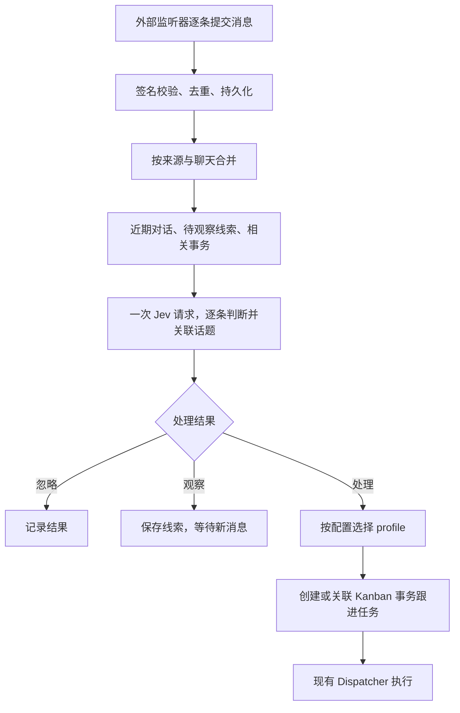

# Hermes WeChat Router

把外部监听器提交的微信消息合并成批次，用 **Jev** 判断与账号本人有关的预约、期限、待办和重要事件，再通过 **Hermes 原生 Kanban** 交给已有的专业 profile。

私聊和群聊都接收。插件内部只调用 TypeSafe 的 System One API；不调用聊天模型、不生成 LLM 摘要。后续 Kanban Agent 使用其 profile 的模型，属于另一次任务执行。

## 工作流程



默认安静窗口 8 秒，最长等待 60 秒；达到 12 条消息也会提前形成批次。不同聊天互不合并，同一聊天的批次按接收顺序处理。每批正文最多 12,000 字符，近期上下文最多 6,000 字符，候选事务最多 8 个。以上是字符/条数上限，不是精确 token 上限。

Jev 对批次内每条消息回答四个 Choice：`action`、`category`、`link`、`phase`。因此一批群消息中的不同话题可以分别派单；“好的”“改到周六”等回复也可以关联较早消息或已有事务。多条同一事务消息合并为一次处理。单条消息包含多个事项时，由接收任务的 Agent 进一步拆分。

## 安装

插件发布在独立的公开仓库中：

```sh
hermes plugins install xyyhhh/hermes-wechat-router --enable
```

需要 Python 3.11+、Hermes 原生平台插件接口和可用的 Kanban。声明最低 Hermes 0.21.4；实际兼容性验收使用官方源码提交 `71736c9f32597bbca9d89cede5aa136e55946b2f`，没有据此声称所有旧版均已实测。当前实现面向 Linux/macOS。

插件是一个由 Gateway 管理的入站平台，平台名为 `wechat_router`，安装 ID 为 `wechat-router`。它需要在 Gateway 所属 profile 运行；平台适配器使用 Hermes 的 in-process 扩展方式。

安装/配置时为该 profile 设置两个密钥：

| 名称 | 用途 |
|---|---|
| `WECHAT_ROUTER_SECRET` | 与外部监听器共享的 HMAC 密钥，至少 32 字节 |
| `TYPESAFE_API_KEY` | TypeSafe Jev API key |

使用 Hermes 自带的安装提示或配置界面录入密钥。插件通过 Hermes 的 profile secret 接口读取，不自行解析 `.env` 或其他凭据文件。

将 [examples/config.yaml](examples/config.yaml) 合并进该 profile 的配置，保留原有其他配置。关键字段：

```yaml
platforms:
  wechat_router:
    enabled: true
    extra:
      mode: observe
      owner_name: 我
      owner_ids: [YOUR_WECHAT_ID]
      sources: [wechat-listener]
      timezone: Asia/Shanghai
      board: default
      triage_profile: inbox
      routes:
        schedule: calendar
        deadline: assistant
        todo: assistant
        important: assistant
        other: inbox
```

`owner_ids`、`sources`、路由中的 profile 名称需要按实际环境设置。提供自己发出的消息、发送者稳定 ID 和 `mentions`，才能更可靠地判断群聊相关性与预约确认状态。目标 profile 必须已经存在，插件不会自动创建 profile。

默认只绑定回环地址。远程监听器通过部署方已有的 HTTPS 入口访问；`host`、`port` 可以配置。插件会在 Gateway 启动时启动 HTTP 接口和队列处理器，关闭时停止接收并取消处理；已接收的消息和未完成批次留在事件库中恢复。

```sh
hermes plugins doctor ~/.hermes/plugins/wechat-router --ci
hermes gateway restart
hermes wechat-router status
```

命名 profile 使用其常规 `hermes -p <profile> ...` 入口。`hermes_bin` 默认从运行 Gateway 的 PATH 查找 `hermes`，也可设置为该环境的 Hermes 可执行文件。

## 接收 API

`POST /wechat-router/v1/events` 接收 JSON，示例见 [examples/message.json](examples/message.json)：

```json
{
  "source": "wechat-listener",
  "event_id": "message-123",
  "conversation_id": "group-456",
  "chat_type": "group",
  "sender_id": "colleague-789",
  "occurred_at": "2026-11-04T16:00:00+08:00",
  "text": "周五下午三点开项目会，可以吗？",
  "mentions": ["YOUR_WECHAT_ID"],
  "is_self": false
}
```

必填：`source`、`event_id`、`conversation_id`、`sender_id`、带时区的 `occurred_at`，以及文本消息的 `text`。可选：`chat_type`（`dm`/`group`）、`conversation_name`、`sender_name`、`reply_to`、`mentions`、`is_self`、`message_type`。`is_self` 缺省时根据 `owner_ids` 推导。

支持 `message_type=text/image/voice/video/file/link/system/other`。非文本消息没有 `text` 时保存占位说明，不做 OCR、语音识别或媒体下载；监听器已有的转写/说明可以放在 `text`。这些内容也参与上下文和后续核对。

### 签名

所有业务接口都要求：

```text
X-Wechat-Router-Timestamp: <当前 Unix 秒数>
X-Wechat-Router-Signature: sha256=<HMAC-SHA256 十六进制值>
```

签名内容为以下 UTF-8 前缀加上原始请求体字节，使用 `WECHAT_ROUTER_SECRET` 作密钥：

```text
v1\n<TIMESTAMP>\n<METHOD>\n<PATH_AND_QUERY>\n<BODY_BYTES>
```

例如 POST 的路径为 `/wechat-router/v1/events`；GET 的签名包含查询字符串，body 为空。默认时间窗口为 300 秒。重试使用相同 `source`/`event_id` 和内容，但重新生成时间戳与签名。签名必须针对最终实际发送的字节，不要签名后重新格式化 JSON。

[examples/send_event.py](examples/send_event.py) 提供只用 Python 标准库的监听器调用示例。它从 stdin 读取 JSON，从环境读取共享密钥：

```sh
python3 examples/send_event.py < examples/message.json
```

### 响应与查询

| 响应 | 含义 |
|---|---|
| 202 | 已持久化接收，尚不代表已调用 Jev 或已建卡 |
| 200，`duplicate=true` | 已接收过相同事件，返回当前状态 |
| 400 / 413 | 格式或大小不符合要求；单条文本上限默认 8,000 字符 |
| 401 | 签名错误或时间戳过期 |
| 409 | 相同 `source`/`event_id` 对应不同内容，需要核对监听器 ID |
| 429 / 503 | 限流或暂时无法保存，监听器应稍后重试 |

`GET /wechat-router/v1/events/status?source=...&event_id=...` 返回批次状态、结构化 Jev 判断、错误码和任务 ID，不返回消息正文。`GET /wechat-router/v1/status` 返回队列及实际 usage 汇总。这两个 GET 也需要签名。

`GET /wechat-router/v1/health` 无需签名，只返回插件名、版本和服务健康标识，不显示队列或消息。

## 派单规则

- `ignore`：保存批次结果，不派单。
- `watch`：保存事务线索；只有后续新消息才再次分析，不为它定时调用 Jev。
- `act`：按类别配置的 profile 创建任务。
- `act` 置信度不足、或类别置信度不足：交给 `triage_profile` 核对。
- 关联不确定时不强行合并；后续 Agent 可根据原消息和已有任务继续核对。

`mode: observe` 会真实调用 Jev并记录判断/usage，但不创建 Kanban 卡。检查结果后改为 `mode: active` 并重启 Gateway。既有 observe 批次不会追溯建卡；进行中的 active 批次改为 observe 后也停止尚未发生的派单。

任务正文是固定模板加消息原文，携带消息发送时间、时区和来源。Jev 不生成任务描述，不确定日期也不由插件编造。Agent 根据其现有职责与用户授权执行后续处理；本插件的任务模板只授权整理、核对、查询和提出候选处理，不自动授予发消息、写日历等权限。

已有事务收到新消息时，插件在原卡追加上下文并创建关联的跟进任务。原任务在 ready/running/todo/review 时，跟进任务依赖原任务完成；原卡已完成、被阻塞或被计划到未来时，跟进任务独立运行，避免新信息被阻塞状态困住。这样不会假设正在工作的 Agent 能实时读到后来追加的评论。

这意味着复用的是 **profile 与事务关联**；插件不会直接向任意存活的 Agent 会话注入消息，也不修改它的运行中 prompt。

## 运维与恢复

```sh
hermes wechat-router status
hermes wechat-router event wechat-listener message-123
hermes wechat-router pause
hermes wechat-router resume
hermes wechat-router retry <batch_id>
```

暂停停止领取新批次，接收接口继续保存消息；正在处理的批次可能完成。命令也可以通过插件目录中的 `python -m wechat_router --home <profile-home> ...` 使用。

事件库位于该 profile 的 `$HERMES_HOME/plugin-data/wechat-router/router.sqlite3`。存储消息原文、观察线索、批次快照、判断和任务关联；目录权限限制为当前用户。第一版不自动清理消息，需按自己的保留策略备份和管理事件库。暂停/禁用不会删除记录。

批次使用持久化租约与心跳，重启后恢复到期租约。同一聊天的重试批次先处理，再处理后续消息。默认最多 3 次，失败后保留错误码并支持手动重试。Jev 成功的判断先保存，后续建卡失败不再次请求模型。建卡带稳定幂等键，避免“创建成功但来不及记录”的重试重复。

插件对普通失败不承诺网络调用恰好一次；如果 Jev 已完成而进程在保存响应前崩溃，恢复时仍可能再次调用。评论按标记尽力去重，Kanban 卡片由原生幂等键去重。不要并行运行多个监听实例指向同一事件库，也不要在任务完成记录前手动归档刚创建的卡。

只发往固定的 TypeSafe HTTPS API，不进行跨提供商回退；不跟随认证重定向，HTTP 客户端不继承代理环境变量。模型调用的原始错误、认证头和正文不会进入插件日志。密钥可以用 Hermes 已有的 secret source 管理。

## 模型与 token

插件只调用配置的 Jev 模型，默认 `jev-latest`。每批一个请求、每条消息四个 typed Choice，无另一个通用 LLM。实际开销取决于正文、上下文、候选事务和问题数量；使用 `status` 中的 `calls`、`input_tokens`、`output_tokens` 观察，不用字符数冒充实际 token 数。HTTP 故障时未拿到 usage 的请求无法从本地精确核算；Jev 真实调用与后续 Agent 都可能产生各自费用。

## 开发与验证

```sh
python3 -m venv .venv
.venv/bin/pip install -e '.[test]'
.venv/bin/python -m pytest -q
.venv/bin/python scripts/verify_hermes.py --hermes-source <official-hermes-checkout>
```

单元/HTTP 测试使用合成消息与本机 Jev fixture。端到端脚本通过真实 Hermes Plugin Doctor、平台适配器启停和真实 Kanban CLI/数据库验证整条链路，但不调用真实 Jev、不访问真实微信，也不启动下游 Agent。这验证协议和恢复行为，不能替代实际消息上的分类质量评估。

参考：[Hermes 插件开发](https://hermes-agent.nousresearch.com/docs/developer-guide/plugins)、[平台适配器](https://hermes-agent.nousresearch.com/docs/developer-guide/adding-platform-adapters)、[Kanban](https://hermes-agent.nousresearch.com/docs/user-guide/features/kanban)、[TypeSafe API](https://docs.typesafe.ai/api/system-one)、[Choice](https://docs.typesafe.ai/primitives/choice)。

MIT License.
